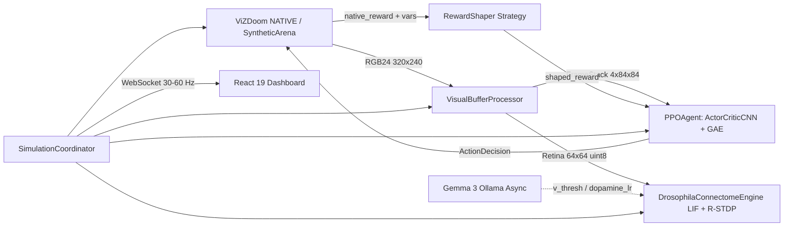

# NeuroDoom OS — Agente RL Visual (PPO-CNN) + Conectoma SNN en ViZDoom

Plataforma neuro-cibernética modular diseñada bajo principios **SOLID** para entrenar y visualizar en tiempo real un agente de Aprendizaje por Refuerzo (**PPO en PyTorch puro**) sobre múltiples escenarios de **ViZDoom (`VIZDOOM_NATIVE`)**, acoplado al conectoma disperso de *Drosophila melanogaster* (SNN LIF + R-STDP), neuromodulación asíncrona con **Gemma 3 (Ollama)** y un dashboard interactivo en **React 19 + FastAPI**.

---

## Tabla de Contenidos
1. [Visión General](#visión-general)
2. [Arquitectura del Sistema](#arquitectura-del-sistema)
3. [Cómo se aplicaron los Principios SOLID](#cómo-se-aplicaron-los-principios-solid)
4. [Flujo de Datos del Buffer Visual (`VIZDOOM_NATIVE`)](#flujo-de-datos-del-buffer-visual-vizdoom_native)
5. [Escenarios Multi-Escenario (`.cfg` / `.wad`)](#escenarios-multi-escenario-cfg--wad)
6. [Guía de Instalación Paso a Paso](#guía-de-instalación-paso-a-paso)
7. [Uso: Entrenamiento CLI y Dashboard en Vivo](#uso-entrenamiento-cli-y-dashboard-en-vivo)
8. [Despliegue en GitHub](#despliegue-en-github)

---

## Visión General

El proyecto desacopla completamente el motor de simulación (**ViZDoom** con respaldo sintético), el pipeline de visión por computadora (**Buffer Visual**), el algoritmo de aprendizaje (**PPO con CNN y GAE**), el conectoma biológico (**SNN dispersa**), el neuromodulador (**Gemma 3**) y la interfaz web en vivo (**React + WebSocket**).

### Características principales
- **PPO en PyTorch puro (`backend/app/rl/`)**: Backbone convolucional *Nature-CNN* (`ActorCriticCNN`), estimación de ventajas generalizadas (**GAE**) en `RolloutBuffer`, objetivo clipeado, regularización por entropía y guardado de checkpoints por escenario.
- **Buffer Visual puro (`backend/app/vision/`)**: Conversión a escala de grises, redimensionamiento a `84×84`, normalización `[0, 1]` y `FrameStack(k=4)` temporal (`(4, 84, 84)`), sin filtrar `labels` internos hacia la entrada de la red neuronal.
- **Arquitectura Multi-Escenario (`backend/app/scenarios/`)**: `ScenarioFactory` + configuraciones declarativas en JSON para `defend_the_center`, `basic`, `defend_the_line`, `deadly_corridor` y `health_gathering`.
- **Dashboard en Tiempo Real (`frontend/`)**:
  - Visualizador en vivo del stream de ViZDoom, del **Buffer Visual procesado (`4×84×84` en mosaico 2×2)** y de la retina biológica `64×64`.
  - Métricas en vivo: Recompensa acumulada, *Loss* PPO (`policy_loss` + `value_loss`), tasa de exploración/explotación (`entropy`) y **FPS reales**.
  - Controles interactivos: Pausar/Reanudar simulación, ajustar velocidad (`Target FPS` y `Tic Skip`), cambiar de escenario en caliente y reiniciar episodios.
- **Conectoma 3D + Gemma 3**: Simulación LIF + R-STDP en tensores dispersos (`torch.sparse.mm`) con visualización 3D en Three.js y ajuste homeostático asíncrono vía Ollama.

---

## Arquitectura del Sistema



### Estructura del Repositorio

```text
FLY_DOOM/
├── backend/
│   ├── app/
│   │   ├── core/
│   │   │   └── interfaces.py          # Contratos ABC/Protocol y DTOs (ISP + DIP)
│   │   ├── vision/
│   │   │   └── preprocessor.py        # Pipeline Grayscale + 84x84 + Norm + FrameStack(4)
│   │   ├── scenarios/
│   │   │   ├── configs/*.json         # Escenarios declarativos (.cfg / .wad)
│   │   │   ├── registry.py            # Carga dinámica de escenarios
│   │   │   ├── reward_shaper.py       # Estrategias de reward shaping
│   │   │   └── factory.py             # ScenarioFactory
│   │   ├── env/
│   │   │   ├── vizdoom_adapter.py     # Adaptador nativo ViZDoom
│   │   │   ├── synthetic_arena.py     # Fallback sintético headless
│   │   │   └── overlay.py             # Detección visual solo para overlay HUD
│   │   ├── rl/
│   │   │   ├── networks.py            # ActorCriticCNN (Nature-CNN)
│   │   │   ├── rollout_buffer.py      # RolloutBuffer + GAE
│   │   │   └── ppo_agent.py           # Algoritmo PPO clipeado
│   │   ├── services/
│   │   │   └── simulation_service.py  # SimulationCoordinator (orquestación)
│   │   ├── connectome_snn.py          # Motor biofísico SNN puro (disperso COO)
│   │   ├── gemma_neuromodulator.py    # Cliente Ollama asíncrono + fallback
│   │   └── main.py                    # Capa delgada FastAPI (REST + WebSocket)
│   ├── Dockerfile
│   └── requirements.txt
├── frontend/                          # Dashboard React 19 + Vite + Tailwind + Three.js
├── scripts/
│   ├── generate_connectome_graph.py   # Generador reproducible del grafo .npz
│   ├── train_ppo.py                   # Entrenador CLI PPO multi-escenario
│   └── neurodoom.sh                   # Automatización local macOS
├── specs/                             # Especificaciones SDD
├── tests/                             # Suite pytest (unit + integración API)
├── .gitignore
├── docker-compose.yml
├── LICENSE
└── Makefile
```

---

## Cómo se aplicaron los Principios SOLID

1. **S — Single Responsibility Principle (Responsabilidad Única)**
   - `VisualBufferProcessor` (`backend/app/vision/preprocessor.py`) solo transforma frames RGB en tensores apilados y mosaicos de depuración.
   - `ViZDoomEnvironmentAdapter` (`backend/app/env/vizdoom_adapter.py`) únicamente gestiona el ciclo de `DoomGame`.
   - `EnemyOverlayDetector` (`backend/app/env/overlay.py`) dibuja overlays visuales sin acoplarse al entrenamiento.
   - `PPOAgent` (`backend/app/rl/ppo_agent.py`) encapsula inferencia, actualización PPO y persistencia.
   - `main.py` actúa únicamente como transporte HTTP/WebSocket.

2. **O — Open/Closed Principle (Abierto/Cerrado)**
   - Nuevos escenarios se añaden creando un JSON en `backend/app/scenarios/configs/` (o usando `ScenarioRegistry.register_json(...)`) sin tocar el código fuente principal.
   - Nuevas estrategias de recompensa se registran mediante `register_reward_shaper(name, cls)` en `backend/app/scenarios/reward_shaper.py`.
   - Nuevos algoritmos RL (p. ej. DQN o SAC) pueden implementarse heredando de `RLAgent` sin modificar `SimulationCoordinator`.

3. **L — Liskov Substitution Principle (Sustitución de Liskov)**
   - `ViZDoomEnvironmentAdapter` y `SyntheticArenaAdapter` implementan exactamente el contrato `EnvironmentAdapter` (`reset`, `step`, `set_tic_skip`, `set_skill`, `close`), siendo intercambiables en caliente en tests, entrenamiento headless o fallbacks.

4. **I — Interface Segregation Principle (Segregación de Interfaces)**
   - `backend/app/core/interfaces.py` divide los contratos en interfaces pequeñas y cohesivas (`VisualPreprocessor`, `RewardShaper`, `EnvironmentAdapter`, `RLAgent`, `ConnectomeEngine`, `Neuromodulator`) para que ningún módulo dependa de métodos que no utiliza.

5. **D — Dependency Inversion Principle (Inversión de Dependencias)**
   - `SimulationCoordinator` (`backend/app/services/simulation_service.py`) y `scripts/train_ppo.py` dependen de abstracciones (`EnvironmentAdapter`, `VisualPreprocessor`, `RLAgent`) inyectadas por constructor/fábrica, no de implementaciones rígidas.

---

## Flujo de Datos del Buffer Visual (`VIZDOOM_NATIVE`)

```text
1. ViZDoom (ScreenFormat.RGB24, RES_320X240)
      │
      ▼  raw_frame: uint8 (240, 320, 3)
2. Conversión a escala de grises + énfasis sutil de canal rojo (amenazas)
      │
      ▼  gray: uint8 (240, 320)
3. Redimensionamiento con cv2.INTER_AREA -> (84, 84)
      │
      ▼  resized: uint8 (84, 84)
4. Normalización flotante -> frame / 255.0 ∈ [0.0, 1.0]
      │
      ▼  norm: float32 (84, 84)
5. Frame Stacking temporal (deque maxlen=4: [t-3, t-2, t-1, t])
      │
      ├──► ActorCriticCNN (B, 4, 84, 84) ──► Logits de Acción + Valor V(s)
      └──► Mosaico 2×2 JPEG Base64 ─────────► Dashboard en vivo (Panel "BUFFER CNN")
```

*Nota didáctica*: Al inicio de cada episodio, la pila de 4 frames se inicializa replicando el primer frame procesado para entregar inmediatamente el tensor `(4, 84, 84)` sin ceros artificiales que distorsionen las capas convolucionales.

---

## Escenarios Multi-Escenario (`.cfg` / `.wad`)

Incluidos de fábrica en `backend/app/scenarios/configs/`:

| ID del escenario | Archivo / Mapa | Acciones | Monstruos / Objetivo |
| --- | --- | --- | --- |
| `defend_the_center` | `defend_the_center.cfg` | 4 | Demonios y Zombiemen en 360° |
| `basic` | `basic.cfg` | 4 | Cacodemon estático / puntería rápida |
| `rocket_basic` | `rocket_basic.cfg` | 4 | Cacodemon con lanzacohetes (`+sv_noautoaim 1`) |
| `predict_position` | `predict_position.cfg` | 4 | Cacodemon en movimiento (predicción temporal) |
| `defend_the_line` | `defend_the_line.cfg` | 4 | Oleadas frontales de Imps y demonios |
| `take_cover` | `take_cover.cfg` | 3 | Escuadrón de DoomImps lanzando bolas de fuego |
| `deadly_corridor` | `deadly_corridor.cfg` | 7 | Pasillo con Zombiemen, ShotgunGuys y ChaingunGuys |
| `deathmatch` | `deathmatch.cfg` | 7 | Horda continua teletransportándose con armas pesadas |
| `freedoom_outpost` | `freedoom2.wad:map04` | 7 | Campaña completa: Imps, ShotgunGuys y LostSouls |
| `freedoom_stronghold` | `freedoom2.wad:map11` | 7 | Campaña completa: Zombiemen, ShotgunGuys e Imps |
| `cyberdemon_boss` | `freedoom2.wad:map31` | 7 | Jefe final: Cyberdemon gigante + DoomImps |
| `health_gathering` | `health_gathering.cfg` | 5 | Navegación y recolección de botiquines en ácido |

### Cómo añadir tu propio `.cfg` / `.wad` sin modificar código
Crea un archivo JSON en `backend/app/scenarios/configs/mi_mapa.json`:
```json
{
  "id": "mi_mapa",
  "name": "Mi Escenario Custom",
  "description": "Mapa personalizado .wad",
  "cfg_file": "basic.cfg",
  "custom_cfg_path": "/ruta/a/mi_mapa.cfg",
  "custom_wad_path": "/ruta/a/mi_mapa.wad",
  "buttons": ["TURN_LEFT", "TURN_RIGHT", "MOVE_FORWARD", "ATTACK"],
  "actions": [
    {"name": "TURN_LEFT", "label": "Girar Izq", "buttons": [1, 0, 0, 0]},
    {"name": "TURN_RIGHT", "label": "Girar Der", "buttons": [0, 1, 0, 0]},
    {"name": "MOVE_FORWARD", "label": "Avanzar", "buttons": [0, 0, 1, 0]},
    {"name": "ATTACK", "label": "Disparar", "buttons": [0, 0, 0, 1]}
  ],
  "game_variables": ["AMMO2", "HEALTH"],
  "episode_timeout": 1200,
  "default_skill": 3,
  "ammo_max": 50.0,
  "reward_shaper": "combat",
  "is_combat": true
}
```
Reinicia el servidor o recarga `ScenarioRegistry` y aparecerá automáticamente en el selector en caliente del dashboard y en `scripts/train_ppo.py`.

---

## Guía de Instalación Paso a Paso

### Requisitos previos
- **Python 3.11**
- **Node.js 22+** y `npm`
- *(Opcional)* **Ollama** con `gemma3:4b` (`ollama pull gemma3:4b`) — si no está activo, el neuromodulador usa homeostasis automática.

### 1. Clonar y crear entorno virtual Python 3.11
```bash
git clone https://github.com/<TU_USUARIO>/<TU_REPO>.git
cd <TU_REPO>

python3.11 -m venv .venv311
source .venv311/bin/activate
pip install --upgrade pip
pip install -r backend/requirements.txt
```

### 2. Generar el conectoma sintético FlyWire (`.npz`)
Dado que los binarios pesados no se suben a GitHub, genera el grafo local reproducible:
```bash
PYTHONPATH=. python scripts/generate_connectome_graph.py
```

### 3. Instalar dependencias del Frontend
```bash
cd frontend
npm install
cd ..
```

### 4. Ejecutar la suite de pruebas (`pytest`)
```bash
PYTHONPATH=. pytest tests/ -v
```

---

## Uso: Entrenamiento CLI y Dashboard en Vivo

### Entrenamiento offline con PPO-CNN
```bash
# Entrenar 50 episodios en defend_the_center
PYTHONPATH=. python scripts/train_ppo.py --scenario defend_the_center --episodes 50

# Entrenar en deadly_corridor o health_gathering
PYTHONPATH=. python scripts/train_ppo.py --scenario deadly_corridor --episodes 40
PYTHONPATH=. python scripts/train_ppo.py --scenario health_gathering --episodes 40

# Entrenar todos los escenarios configurados
PYTHONPATH=. python scripts/train_ppo.py --all-scenarios --episodes 20
```

### Levantar el Dashboard Interactivo en Vivo
Opción rápida (macOS):
```bash
make demo
```
O manualmente en dos terminales:
```bash
# Terminal 1 (Backend FastAPI)
PYTHONPATH=. .venv311/bin/uvicorn backend.app.main:app --reload --port 8000

# Terminal 2 (Frontend React + Vite)
cd frontend && npm run dev -- --port 3000
```
Abre `http://localhost:3000` y entra a **2. Laboratorio en Vivo (Mission Control)**.

---

## Despliegue en GitHub

Si el repositorio aún no está inicializado o tiene artefactos rastreados previamente, ejecuta estos comandos exactos desde la raíz del proyecto:

```bash
# 1. Inicializar repositorio Git en rama main
git init -b main

# 2. Verificar que .gitignore excluye venv, node_modules, *.pt, *.npz, *.png y logs
git status --ignored

# 3. (Solo si ya existía un repo previo con binarios cacheados)
# git rm -r --cached data/*.pt data/*.npz *.png .venv311 venv frontend/node_modules 2>/dev/null || true

# 4. Añadir archivos limpios y crear commit inicial
git add .
git status
git commit -m "feat: SOLID architecture, PPO-CNN visual RL, multi-scenario ViZDoom & live dashboard"

# 5. Conectar con tu repositorio remoto en GitHub y subir
git remote add origin https://github.com/<TU_USUARIO>/<TU_REPO>.git
git push -u origin main
```

---

## Licencia
Distribuido bajo licencia **MIT**. Consulta el archivo [`LICENSE`](LICENSE) para más detalles.
